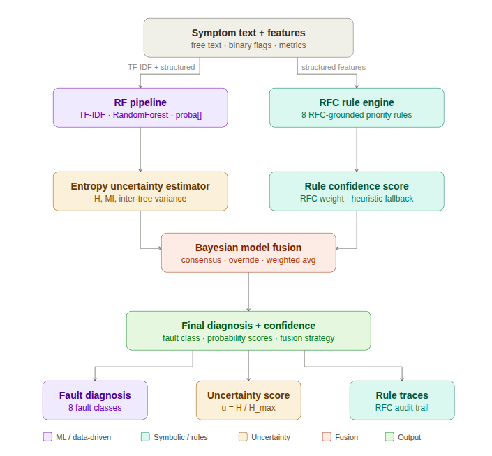
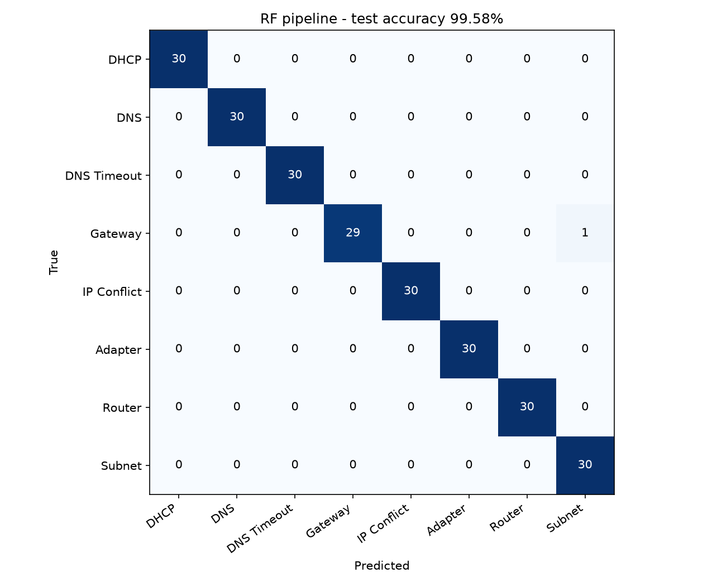
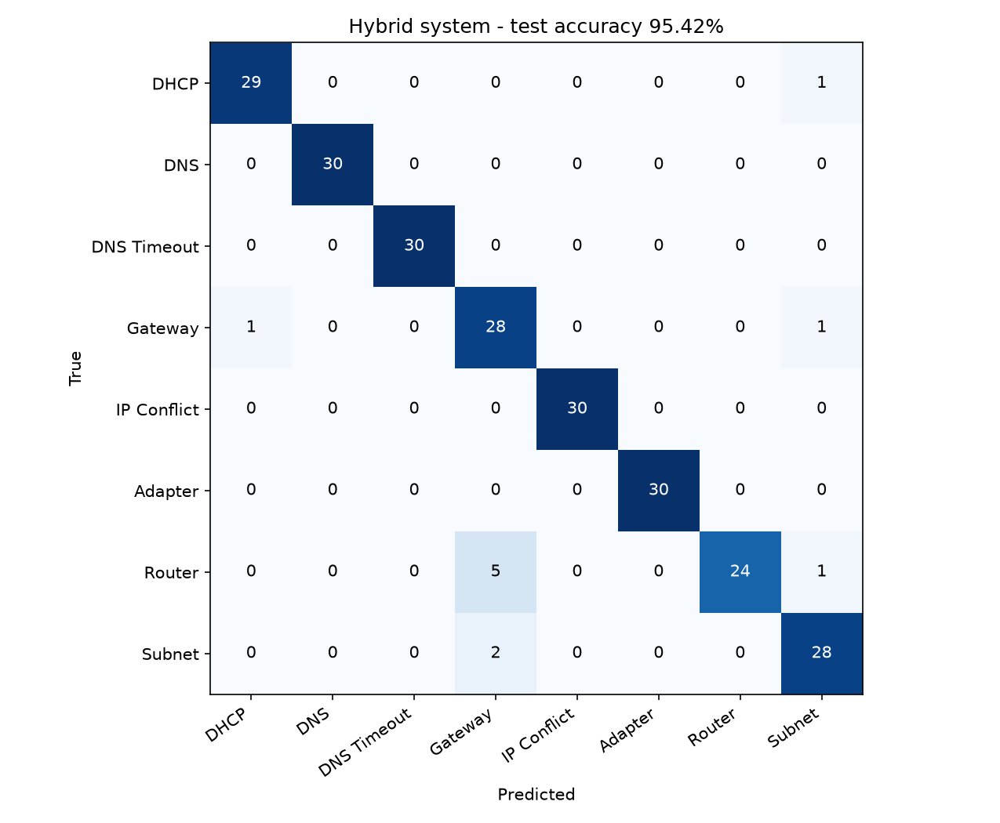

# Hybrid Network Fault Diagnosis (ML + Expert System + Bayesian Fusion)

A network troubleshooting assistant that diagnoses **8 common network faults** from a
plain-English symptom description plus 10 diagnostic measurements. It combines:

1. a **TF-IDF + Random Forest** pipeline (pattern learning from text and measurements),
2. an **RFC-grounded expert rule engine** (8 priority-ordered rules based on RFC 826, 1035, 1122, 2131),
3. a **predictive-entropy uncertainty estimator** built from the forest's 200 trees, and
4. an **uncertainty-weighted Bayesian fusion layer** that reconciles the two experts,

all served through a three-step **Streamlit** web app with confidence scores, rule traces
and step-by-step remediation.

Fault classes: Router Issue · DNS Issue · DNS Timeout · IP Conflict · DHCP Failure ·
Gateway Unreachable · Network Adapter Issue · Subnet Mismatch.

<p align="center">
  
</p>

## Results

Measured with `python src/evaluate.py` on the synthetic dataset (1,200 samples, stratified
80/20 split, seed 42). Full analysis: [docs/RESULTS.md](docs/RESULTS.md).

| System | Test accuracy | Notes |
|---|---:|---|
| **RF pipeline** (TF-IDF + structured features) | **99.58 %** (239/240) | 5-fold CV on the training set: **99.58 % ± 0.21 %** |
| Rule engine only | 94.17 % | no learning, fully explainable |
| Hybrid (RF + rules + Bayesian fusion) | 95.42 % | changes 10 RF predictions, all 10 for the worse |
| RF, structured features only | 95.42 % | ablation |
| TF-IDF text only | 100.00 % | the text is a lookup key on this data (see caveats) |

**What the hybrid layer adds:** explanations (RFC rule traces, fusion strategy), better
calibration (expected calibration error 0.042 vs 0.071 for the RF) and an uncertainty
signal: correct predictions average u = 0.13, the RF's single test error has u = 0.56, and
10.8 % of test cases cross the u > 0.30 review threshold.
**What it costs:** on this dataset the rule override lowers accuracy from 99.58 % to 95.42 %.

On 9 hand-written scenarios phrased in new words ([tests/scenarios.json](tests/scenarios.json)),
the RF gets 9/9 and the hybrid 8/9.

> **Caveats:** the data is synthetic. Each class uses only 20 fixed symptom sentences,
> and every test sentence also appears in training, so the text features act as a label
> lookup. The accuracy figures describe this generator, not real help-desk traffic.
> See [docs/RESULTS.md](docs/RESULTS.md#4-limitations).

<p align="center">
  
  
</p>

## Repository structure

```
Hybrid-Network-Fault-Diagnosis/
├── src/
│   ├── config.py           # paths, feature schema, classes, remediation steps
│   ├── dataset.py          # synthetic dataset generator (reproduces data/ exactly)
│   ├── train.py            # TF-IDF + Random Forest training, proper 5-fold CV
│   ├── rule_engine.py      # RFC-grounded expert rules (decision list)
│   ├── rf_uncertainty.py   # entropy / mutual information / inter-tree variance
│   ├── bayesian_fusion.py  # consensus / override / Bayesian averaging
│   ├── hybrid_system.py    # end-to-end hybrid diagnosis
│   ├── evaluate.py         # all reported metrics, ablations, scenarios, figures
│   └── app.py              # Streamlit web application
├── data/network_dataset_v3.csv
├── models/                 # pipeline.pkl, encoders.pkl, training_report.json
├── results/                # metrics.json, evaluation_report.md, figures/
├── tests/                  # pytest suite + 15 hand-written scenarios
├── docs/                   # methodology, results, Windows setup, migration notes
├── archive/                # earlier Decision-Tree version and original sources
├── requirements.txt
└── setup_env.ps1           # one-command Windows environment setup
```

## Quick start (Windows 11, PowerShell)

Requirements: Python 3.10–3.12 (tested with 3.12) and Git.

```powershell
git clone https://github.com/shivamd2502/Hybrid-Network-Fault-Diagnosis.git
cd Hybrid-Network-Fault-Diagnosis
powershell -ExecutionPolicy Bypass -File .\setup_env.ps1
.\.venv\Scripts\Activate.ps1

streamlit run src\app.py          # web app at http://localhost:8501
```

Reproduce everything from scratch:

```powershell
python src\dataset.py             # regenerate data\network_dataset_v3.csv (byte-identical)
python src\train.py               # train + 5-fold CV -> models\
python src\evaluate.py            # metrics, ablations, scenarios -> results\
python -m pytest tests -q         # 23 tests
```

Linux/macOS: `python3 -m venv .venv && source .venv/bin/activate && pip install -r requirements.txt`,
then the same commands with `/` paths.

## How a diagnosis is made

1. **Symptom text** -> TF-IDF (100 uni/bi-grams); **measurements** -> 7 binary flags
   (gateway ping, valid IP, external ping, DNS resolution, IP conflict, ARP OK, subnet match)
   and 3 metrics (DNS response time, packet loss, traceroute hops), plus connection type and OS.
2. The **Random Forest** (200 trees) outputs a probability per class. Its normalised entropy
   `u = H / ln 8` is the uncertainty.
3. The **rule engine** fires the first matching RFC rule (for example "ping IP works,
   domains fail, DNS > 8 s -> DNS Timeout, 0.82") and spreads the remaining probability
   over partially matching classes.
4. **Fusion:** if both agree -> consensus. If they disagree and only one is confident
   (u < 0.30) -> that one wins. Otherwise -> reliability-weighted Bayesian average.

Details and equations: [docs/METHODOLOGY.md](docs/METHODOLOGY.md) and
[docs/Hybrid_Diagnostic_System_Math_Architecture.pdf](docs/Hybrid_Diagnostic_System_Math_Architecture.pdf).

## Documentation

- [docs/METHODOLOGY.md](docs/METHODOLOGY.md): dataset design, model, rules, uncertainty, fusion
- [docs/RESULTS.md](docs/RESULTS.md): all results, comparison with earlier reported numbers, limitations
- [docs/WINDOWS_SETUP.md](docs/WINDOWS_SETUP.md): environment, running the app, troubleshooting
- [docs/MIGRATION_NOTES.md](docs/MIGRATION_NOTES.md): what changed moving from Ubuntu to Windows
- [archive/README.md](archive/README.md): earlier versions kept for reference

## Publication

Accepted at **IEEE KALINGACONF'26**.
