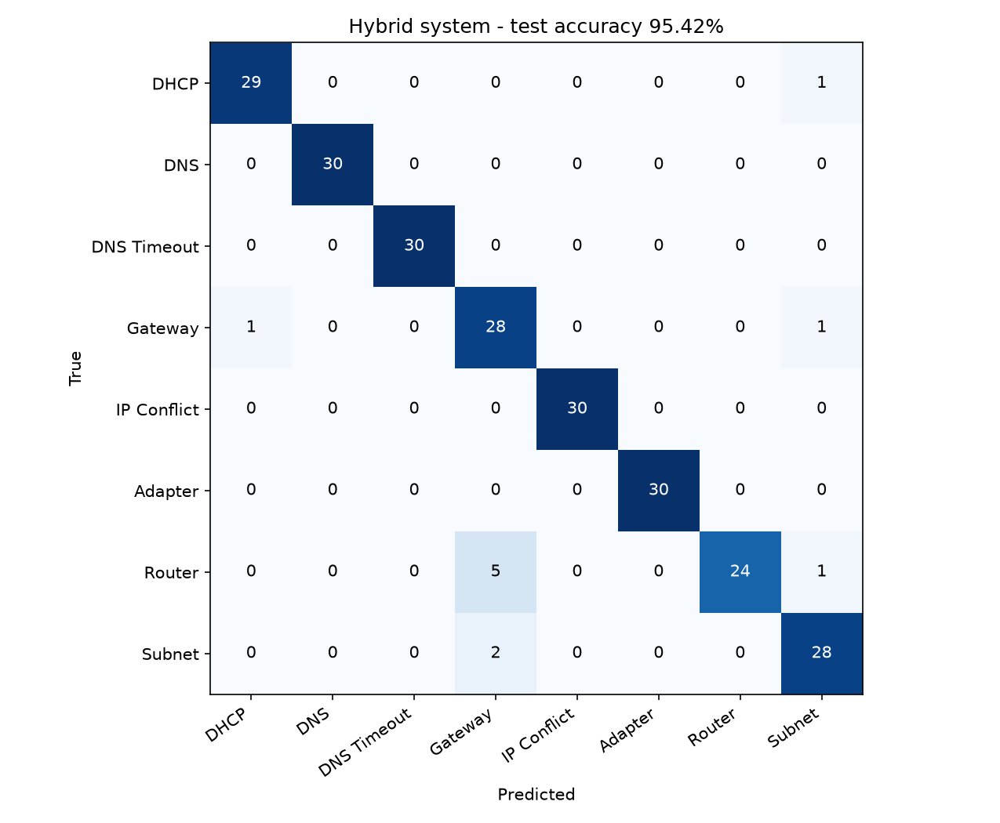

# Results

All numbers come from `python src/evaluate.py` (raw values in
[`results/metrics.json`](../results/metrics.json), tables in
[`results/evaluation_report.md`](../results/evaluation_report.md)). Dataset: 1,200 synthetic
samples (150 per class), stratified 80/20 split with seed 42 (960 train / 240 test).

## 1. Test set

| System | Accuracy | Macro-F1 | Errors |
|---|---:|---:|---:|
| RF pipeline (TF-IDF + structured) | **99.58 %** | 0.9958 | 1 / 240 |
| Rule engine only | 94.17 % | 0.9417 | 14 / 240 |
| Hybrid (RF + rules + Bayesian fusion) | 95.42 % | 0.9544 | 11 / 240 |

The RF's only error is a Gateway Unreachable sample predicted as Subnet Mismatch.

**How the fusion layer behaves:**

| Fusion strategy | Test samples | Hybrid accuracy |
|---|---:|---:|
| consensus (RF and rules agree) | 227 | 99.56 % |
| rule_override (rules confident, RF uncertain) | 8 | **0 %** |
| bayesian_fusion (disagree, both or neither confident) | 5 | 60 % |

The hybrid changes 10 of the RF's predictions. All 10 changes are wrong (0 fixed, 10 broken),
half of them Router Issue samples relabelled as Gateway Unreachable (the other five:
Subnet Mismatch -> Gateway ×2, Router -> Subnet, DHCP -> Subnet, Gateway -> DHCP). Each rule fires with a fixed
confidence of 0.78–0.98, so its "uncertainty" (1 − confidence) is always below the 0.30
override threshold. Whenever the RF is unsure (u ≥ 0.30) and disagrees, the less accurate
rule engine therefore wins.

## 2. Cross-validation (RF pipeline)

| Procedure | Mean ± std |
|---|---:|
| 5-fold stratified CV on the **training set** (960 samples) | **99.58 % ± 0.21 %** |
| Original script: 5-fold CV on the **test set only** (240 samples) | 98.75 % ± 1.67 % |

The previously reported "98.75 % ± 1.67 %" is the second line: the original training
script ran `cross_val_score(pipeline, X_test, y_test)`, so each fold trained on only 192
test samples. The correct figure is the first line.

## 3. Ablation (test accuracy)

| Variant | Measured | Previously reported |
|---|---:|---:|
| Decision Tree, structured features, depth 5 | 93.33 % | 54.50 % |
| RF, structured features only | 95.42 % | 87.30 % |
| TF-IDF text only | 100.00 % | 91.25 % |
| Rule engine only | 94.17 % | 88.00 % |
| RF + TF-IDF + structured | 99.58 % | 99.17 % / 99.58 % |
| Full hybrid | 95.42 % | 99.58 % |

The "previously reported" column comes from the earlier report and paper drafts. No script
in the original project computes those values, and running the same models gives the
measured column. Use the measured values.

## 4. Limitations

**Text is a lookup key on this dataset.** Each class has exactly 20 symptom sentences, and
100 % of test sentences also occur in the training set. One sentence ("cannot ping the
default gateway address") is shared by Router Issue and Gateway Unreachable. As a result:

- TF-IDF text alone reaches 100 % test accuracy.
- Shuffling `symptom_text` between test rows drops the RF to 87.50 %, so the model leans
  heavily on memorised sentences.

**Generalisation check.** The 15 hand-written scenarios in [`tests/scenarios.json`](../tests/scenarios.json)
use wording that never appears in the dataset:

| | RF | Rules | Hybrid |
|---|---:|---:|---:|
| Labelled scenarios correct (9) | 9 | 8 | 8 |
| Ambiguous scenarios with a plausible answer (6) | 6 | 6 | 6 |

The hybrid's miss is scenario 1 ("all devices lost internet, router page not opening", a
Router Issue). The rules say Gateway Unreachable, and Bayesian fusion follows them.

**Other limitations:**
- Synthetic data only. Real users often cannot report DNS latency, ARP state or packet loss.
- The fusion reliabilities (0.996 for the RF, 0.880 for the rules) are fixed values. The
  measured rule-engine accuracy is 94.17 % on the test set and 93.50 % on the full dataset.
- The rule-engine and fusion confidences are hand-set, not learned.

## 5. Uncertainty

| Quantity | Value |
|---|---:|
| Mean RF uncertainty u, correct test predictions | 0.133 |
| RF uncertainty of its single test error | 0.558 |
| Test samples with u > 0.30 (would be flagged for review) | 10.8 % |
| Expected calibration error, RF | 0.071 |
| Expected calibration error, hybrid | 0.042 |

Uncertainty on three hand-written demo inputs (`python src/hybrid_system.py`), which are the
cases quoted in the earlier report:

| Case | Confidence | u | Entropy (nats) | MI |
|---|---:|---:|---:|---:|
| IP Conflict | 98.9 % | 5.7 % | 0.1180 | 0.1037 |
| DNS Timeout | 92.5 % | 11.6 % | 0.2422 | 0.2060 |
| DHCP Failure | 90.7 % | 40.1 % | 0.8337 | 0.6711 |

## 6. Suggested improvements

1. **Fix the override rule.** Give the rule engine its measured reliability and a learned
   or calibrated confidence. Alternatively, only let rules override when the RF's
   uncertainty is high *and* the rule's measured precision for that class is higher.
2. **Make the text realistic.** Generate paraphrases (or use held-out sentence banks) so
   test sentences never appear in training. Report accuracy on unseen phrasing.
3. **Collect a small real dataset** (even 50–100 labelled help-desk tickets) for an honest
   external test.
